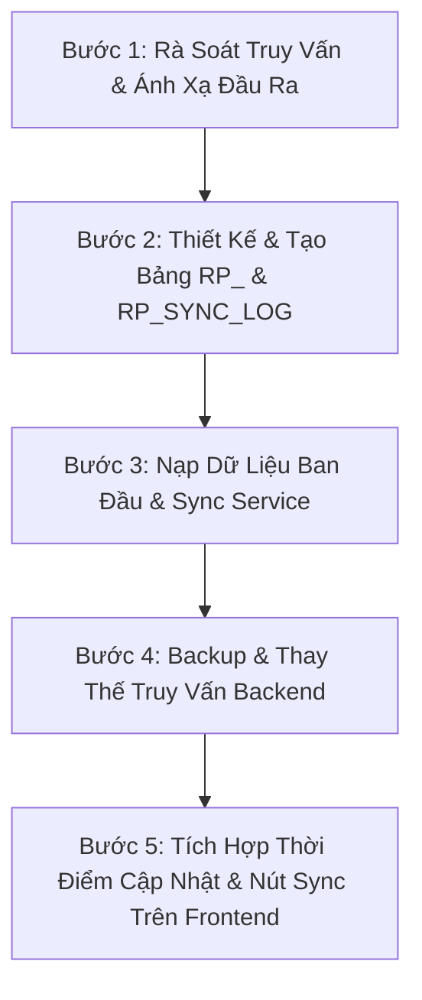

# SKILL: NÂNG CẤP BÁO CÁO ERP SANG TRUY VẤN THEO BẢNG REPORT (RP_*)

## 📌 BỐI CẢNH VÀ MỤC TIÊU
Trong hệ thống ERP doanh nghiệp sản xuất, các bảng backdata như giao hàng (`ZTBDelivery`), đơn hàng (`ZTBPOTable`), công đoạn sản xuất (`P400`), xuất kho (`O660`)... chứa từ hàng triệu đến hàng chục triệu dòng. Khi các trang báo cáo gọi 10-30 truy vấn đồng thời join nhiều bảng lớn và tính toán tổng hợp on-the-fly, thời gian phản hồi thường kéo dài nhiều phút, gây quá tải CPU/RAM của SQL Server và làm treo axios request trên web.

**Mục tiêu của Skill**:
1. Chuyển đổi phương thức truy vấn từ quét trực tiếp backdata sang truy vấn từ các bảng tổng hợp (Summary Tables) có tiền tố `RP_`.
2. Giảm thời gian phản hồi từ 30s-120s xuống còn **dưới 100ms**.
3. **Bảo toàn 100% Frontend**: Không thay đổi bất kỳ dòng code, giao diện hay payload gọi API nào trên Frontend.
4. **Bảo toàn Truy Vấn Cũ (Backup)**: Toàn bộ code truy vấn cũ ở Backend được comment lưu lại làm bản đối chiếu lịch sử.

---

## ⚡ 6 NGUYÊN TẮC VÀNG BẮT BUỘC
> [!IMPORTANT]
> 1. **FRONTEND COMPATIBILITY & METADATA CONTRACT**: 
>    - Toàn bộ tên API command, cấu trúc payload và dữ liệu báo cáo trả về cho bảng biểu/biểu đồ phải giữ nguyên 100%.
>    - **Chuẩn hóa Metadata thời gian**: Cung cấp cơ chế để Frontend đọc được thời điểm cập nhật mới nhất của báo cáo (`LAST_SYNC_AT`) và tích hợp nút **"Cập nhật dữ liệu mới nhất"** cho người dùng.
> 2. **BACKEND BACKUP FIRST**: Tại từng handler trong Service Backend, comment toàn bộ khối truy vấn SQL cũ trước khi viết khối truy vấn mới.
> 3. **TIỀN TỐ BẢNG BÁO CÁO `RP_`**: Tất cả các bảng summary tạo mới trên SQL Server phải bắt đầu bằng `RP_` (ví dụ: `RP_KD_DELIVERY_DAILY`, `RP_KD_PO_BALANCE_WEEKLY`...).
> 4. **XỬ LÝ PIVOT ĐỘNG (PRE-PIVOT TABLE)**:
>    - Đối với các báo cáo có cột động (Pivot theo ngày, theo tuần, theo tháng...): Bảng `RP_` chỉ lưu dữ liệu tổng hợp **TRƯỚC KHI PIVOT** (Pre-Pivot granularity).
>    - Khi người dùng truy vấn, câu lệnh SQL sẽ lấy các cột động và thực hiện `PIVOT` trực tiếp trên bảng `RP_` cực kỳ gọn nhẹ (thay vì quét qua toàn bộ backdata).
> 5. **CƠ CHẾ ĐỒNG BỘ DỮ LIỆU (TRANSACTION DATA VS. BALANCE DATA)**:
>    - **Dữ liệu Giao dịch / Sự kiện (Transaction / Event Data)** như Doanh thu, Giao hàng theo ngày, Quá hạn: Có thể đồng bộ rolling N ngày (ví dụ 60 ngày) để cập nhật phát sinh mới.
>    - **Dữ liệu Tồn / Số dư / Trạng thái mở (Balance / State Data)** như Tồn đơn hàng (PO Balance), Tồn kho: Đơn hàng có thể tồn qua nhiều năm, bị hủy hoặc clear gần đây. **Bắt buộc PHẢI FULL SYNC toàn bộ lịch sử** (hoặc snapshot toàn bộ đơn Open). Tuyệt đối KHÔNG xóa năm hiện tại rồi chỉ chèn lại 60 ngày, sẽ làm mất sạch các tuần/tháng đầu năm!
> 6. **QUY TẮC GROUP BY & HAVING KHI BÁO CÁO TỔNG HỢP ĐA TẦNG**:
>    - Khi bảng `RP_` lưu dữ liệu ở cấp độ con (VD: từng Khách hàng theo tuần), nhưng biểu đồ hiển thị ở cấp độ cha (VD: tổng hợp cả Tuần hoặc cả Năm):
>    - Tuyệt đối KHÔNG đặt điều kiện lọc `PO_BALANCE > 0` trong `WHERE` trước khi `GROUP BY` cha (sẽ loại bỏ các khách hàng có tồn = 0, làm tụt giảm sai lệch cột tổng đặt `PO_QTY` và tổng giao `DELIVERY_QTY`).
>    - **Bắt buộc dùng `HAVING SUM(PO_BALANCE) > 0`** để vừa bảo toàn 100% số lượng đặt & giao, vừa chỉ lọc hiển thị các tuần/năm thực sự còn tồn.
> 7. **BẢNG QUẢN LÝ NHẬT KÝ ĐỒNG BỘ (`RP_SYNC_LOG`) & MANUAL TRIGGER**:
>    - Quản lý tập trung trạng thái và timestamp đồng bộ của từng phân hệ báo cáo qua bảng `RP_SYNC_LOG`.
>    - Cung cấp API để Frontend đọc thời gian cập nhật và cho phép người dùng click **"Cập nhật dữ liệu mới nhất"** (`force: true`) để chủ động tổng hợp backdata rolling tức thì mà không cần chờ cronjob.
> 8. **CENTRAL REGISTRY & BỘ LẬP LỊCH CHUNG 10 PHÚT (RELOAD GUARD)**:
>    - Toàn bộ báo cáo của các phân hệ (Kinh Doanh, Sản Xuất, Kho, QC...) được quản lý tập trung qua `REPORT_REGISTRY` với định mức refresh chung mặc định là **10 phút**.
>    - **Nguyên tắc Guard khi khởi động lại Backend**: Kể cả khi restart server/service, nếu tính từ lần cập nhật gần nhất (`LAST_SYNC_AT` trong `RP_SYNC_LOG`) tới hiện tại mà **chưa đủ 10 phút thì TUYỆT ĐỐI KHÔNG CHẠY** đồng bộ lại (trả về trạng thái `SKIPPED`).
>    - **Cơ chế Polling Check 60 giây**: Scheduler chạy vòng lặp kiểm tra nhẹ mỗi 60 giây (truy vấn DB `DATEDIFF(second, LAST_SYNC_AT, GETDATE())`), chỉ khi báo cáo nào chạm mốc `>= 600 giây` mới kích hoạt hàm sync. Tránh trường hợp dùng `setInterval` cố định bị cộng dồn thời gian khi server restart giữa chừng.

---

## 🛠️ QUY TRÌNH 5 BƯỚC THỰC HIỆN CHUẨN



---

### BƯỚC 1: RÀ SOÁT TRUY VẤN VÀ ÁNH XẠ ĐẦU RA (AUDIT & MAPPING)
1. Mở file Hook/Component của trang báo cáo trên Frontend (VD: `useKDReportData.ts`, `kdReportQueries.ts`).
2. Liệt kê toàn bộ các command `generalQuery` được gọi:
   - Các tham số đầu vào: `CTR_CD`, `START_DATE`, `END_DATE`, bộ lọc chuyên biệt (`IN_NHANH`, `D_PLUS`, loại hình...).
   - Các trường đầu ra của từng truy vấn: Tên trường chính xác, kiểu dữ liệu (`DELIVERY_DATE`, `DELIVERY_QTY`, `DELIVERED_AMOUNT`, `KPI_VALUE`...).
3. Phân nhóm các truy vấn theo miền dữ liệu chung (VD: Doanh thu giao hàng, Quá hạn, Tồn đơn PO...) để tối ưu hóa số lượng bảng `RP_`.

---

### BƯỚC 2: THIẾT KẾ BẢNG `RP_` & BẢNG QUẢN LÝ `RP_SYNC_LOG`
1. **Thiết kế bảng dữ liệu `RP_`**:
   - **Độ mịn (Granularity)**: Lưu ở cấp độ mịn nhỏ nhất mà các báo cáo cần nhóm (thường là Ngày x Khách hàng x Phân loại).
   - **Chỉ mục (Indexes)**: Tạo clustered/non-clustered index trên `(CTR_CD, DELIVERY_DATE)` để lọc tức thì.
   - **Kiểu dữ liệu số**: Khi tính SUM hoặc lưu vào bảng, lưu ý ép kiểu số phù hợp để khi trả về Node.js/mssql không bị biến thành `String` (đặc biệt là kiểu `BIGINT` cần `CAST(... AS FLOAT)` khi query trả về cho biểu đồ Recharts).
2. **Khởi tạo bảng quản lý nhật ký đồng bộ `RP_SYNC_LOG`**:
   ```sql
   IF NOT EXISTS (SELECT * FROM sys.tables WHERE name = 'RP_SYNC_LOG')
   BEGIN
     CREATE TABLE RP_SYNC_LOG (
       REPORT_CODE VARCHAR(50) NOT NULL PRIMARY KEY,   -- VD: 'KINH_DOANH', 'SAN_XUAT', 'KHO'
       REPORT_NAME NVARCHAR(255) NULL,
       LAST_SYNC_AT DATETIME NOT NULL DEFAULT GETDATE(),
       STATUS VARCHAR(20) NOT NULL DEFAULT 'OK',
       MESSAGE NVARCHAR(500) NULL,
       DURATION_MS INT NULL,
       UPDATED_BY NVARCHAR(100) NULL
     );
   END;
   ```

---

### BƯỚC 3: NẠP DỮ LIỆU BAN ĐẦU, CƠ CHẾ SYNC ENGINE & CENTRAL REGISTRY
1. Viết script migration nạp toàn bộ dữ liệu lịch sử từ backdata.
2. Xây dựng Service đồng bộ (VD: `reportSyncService.js`):
   - Hàm `syncRP[PhânHệ](days, ctrCd)`: Xóa và nạp lại dữ liệu rolling (VD: 30 - 60 ngày gần nhất) để hứng toàn bộ thay đổi mới.
   - Khi hoàn thành sync: Sử dụng `MERGE RP_SYNC_LOG` cập nhật `LAST_SYNC_AT = GETDATE()`, `DURATION_MS`, `STATUS = 'OK'`.
   - Cung cấp hàm `getReportSyncInfo(reportCode)`: Trả về `LAST_SYNC_AT` định dạng chuỗi `YYYY-MM-DD HH:mm:ss`.
3. **Đăng ký vào Central Registry & Bộ Lập Lịch Chung 10 Phút**:
   - Khai báo phân hệ báo cáo vào `REPORT_REGISTRY` chung của hệ thống:
     ```javascript
     registerReportSync({
       code: 'SAN_XUAT', // hoặc 'KHO', 'MUA_HANG', 'QC'
       name: 'Báo Cáo Sản Xuất',
       department: 'SX',
       minIntervalMinutes: 10, // Chu kỳ tối thiểu 10 phút
       syncFn: async (ctrCd) => await syncRPSanXuat(60, ctrCd),
     });
     ```
   - **Cơ chế Scheduler & Guard 10 Phút**:
     - Hàm `shouldSyncReport(reportCode, minIntervalMinutes = 10)`: Quét `DATEDIFF(second, LAST_SYNC_AT, GETDATE())` trong bảng `RP_SYNC_LOG`. Nếu `< 600s` thì `shouldSync: false` (bỏ qua).
     - Scheduler chạy vòng lặp kiểm tra định kỳ mỗi 60 giây và kích hoạt tự động sau 15 giây khi server khởi động (đảm bảo chống reload lặp khi restart server).

---

### BƯỚC 4: BACKUP & THAY THẾ TRUY VẤN Ở BACKEND
1. Mở service backend tương ứng (VD: `services/kinhdoanhService.js`).
2. Với từng hàm handler:
   - Comment lại toàn bộ câu lệnh SQL cũ:
     ```javascript
     /* ==================== BACKUP TRUY VẤN CŨ (BACKDATA DIRECT) ====================
     ... (toàn bộ query cũ được giữ nguyên) ...
     ============================================================================= */
     ```
   - Viết truy vấn mới lấy từ bảng `RP_`. Giữ nguyên 100% Aliases tên cột đầu ra.
   - **Lưu ý chuỗi Dynamic Pivot SQL**: Trong T-SQL dynamic query `@query = '...'`, giá trị chuỗi chỉ dùng 2 dấu nháy đơn (`''${DATA.CTR_CD}''`, `''TOTAL''`), không dùng 4 dấu nháy đơn.
3. Thêm 2 endpoint API chuẩn cho phân hệ báo cáo:
   - `getReportSyncInfo`: Cho Frontend đọc thời điểm `LAST_SYNC_AT`.
   - `triggerReportSync`: Cho Frontend kích hoạt đồng bộ dữ liệu tức thì từ backdata.

---

### BƯỚC 5: TÍCH HỢP THỜI ĐIỂM CẬP NHẬT & NÚT LÀM MỚI TRÊN FRONTEND
1. **API Client & Hook**:
   - Khai báo hàm `queryReportSyncInfo` và `triggerReportSyncAPI`.
   - Hook báo cáo quản lý state `lastSyncTime` và `isSyncing`.
   - Tự động nạp `lastSyncTime` mỗi khi mở trang hoặc tải báo cáo.
2. **Giao diện Header Bar / Toolbar**:
   - **Hiển thị nhãn thời gian**:
     ```tsx
     <div className="precision-kd-header__sync-info" title="Thời điểm cơ sở dữ liệu báo cáo được cập nhật mới nhất">
       <FiClock size={12} className="sync-clock-icon" />
       <span className="sync-label">Dữ liệu cập nhật:</span>
       <strong className="sync-time">{lastSyncTime || "Đang tải..."}</strong>
     </div>
     ```
   - **Nút "Cập nhật dữ liệu mới nhất"** (nằm cạnh nút Toàn màn hình):
     ```tsx
     <button
       type="button"
       className={`precision-kd-header__btn-action precision-kd-header__btn-sync ${isSyncing ? "is-loading" : ""}`}
       onClick={handleSyncLatest}
       disabled={isSyncing}
       title="Đồng bộ dữ liệu phát sinh mới nhất từ hệ thống và nạp lại toàn bộ báo cáo"
     >
       <FiRefreshCw size={12} className={isSyncing ? "animate-spin" : ""} />
       <span>{isSyncing ? "Đang Cập Nhật..." : "Cập Nhật Dữ Liệu Mới Nhất"}</span>
     </button>
     ```
   - Khi bấm nút: Bật loading spinner, gọi `triggerReportSyncAPI`, sau khi đồng bộ thành công tự động gọi lại hàm nạp toàn bộ số liệu báo cáo và hiển thị thông báo Swal/Toast.

---

## 📋 DANH MỤC KIỂM TRA ĐẢM BẢO CHẤT LƯỢNG (CHECKLIST)
- [ ] Bảng `RP_` có index đầy đủ, truy vấn chạy < 100ms.
- [ ] Các bảng số dư tồn (PO Balance, Tồn kho) phải được Full Sync hoặc snapshot toàn bộ đơn Open, không dùng rolling làm mất tuần cũ.
- [ ] Truy vấn tổng hợp cha/con dùng `HAVING SUM(BALANCE) > 0` thay vì `WHERE BALANCE > 0` để tránh làm hỏng các cột tổng đặt/tổng giao.
- [ ] Bảng `RP_SYNC_LOG` lưu trữ đầy đủ `LAST_SYNC_AT` sau mỗi lượt đồng bộ.
- [ ] Đăng ký báo cáo vào `REPORT_REGISTRY` với định mức tối thiểu 10 phút và tích hợp Reload Guard kiểm tra `LAST_SYNC_AT` chống spam khi khởi động backend.
- [ ] Có API `getReportSyncInfo` và `triggerReportSync` hoạt động chính xác.
- [ ] Toàn bộ query cũ ở backend đã được comment backup bảo lưu.
- [ ] Đầu ra dữ liệu của truy vấn mới khớp 100% cấu trúc và kết quả với truy vấn cũ.
- [ ] Frontend hiển thị rõ "Dữ liệu cập nhật: YYYY-MM-DD HH:mm:ss" trên Header.
- [ ] Nút "Cập Nhật Dữ Liệu Mới Nhất" (Làm Mới) hoạt động trơn tru kèm hiệu ứng loading xoay.
- [ ] Cập nhật `ROADMAP.md` và `CONTEXT.md` đầy đủ sau khi hoàn thành.
